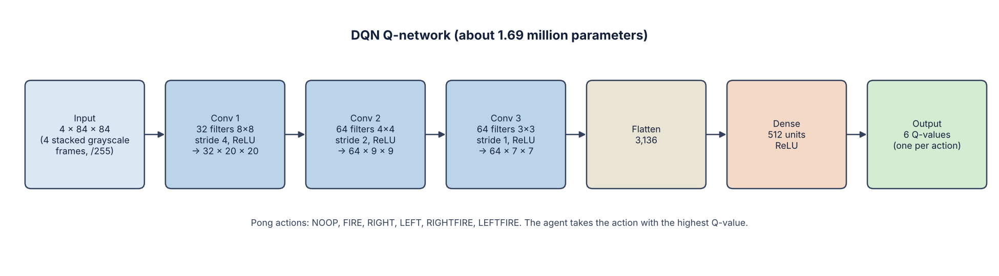
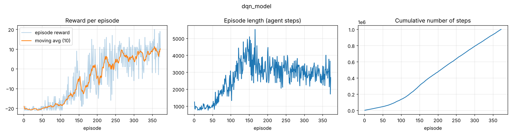

# DQN Atari - Group 16

Deep Q-Network (DQN) agent trained on Atari Pong (`ALE/Pong-v5`) using Gymnasium and PyTorch. The DQN is implemented from scratch with `torch.nn`; no ready-made DQN library (Stable-Baselines3, RLlib, CleanRL, TorchRL) is used.

- **Repository:** https://github.com/DavidPontient/Formative-3-Assignment-Deep-Q-Learning-group16.git
- **Presentation slot:**

---

## 1. Project Introduction

### Group Members

| Member | Role | Main Deliverables |
|---|---|---|
| Shem Ayioka (Member A) | Core DQN | CNN Q-network, replay buffer, epsilon-greedy, Bellman update, `train.py`, final `dqn_model.pth` |
| David Pontient Kayumba (Member B) | Environment, evaluation and repo | Environment and preprocessing, `play.py`, `uv` project setup, gameplay video |
| Rachel Toronga (Member C) | Logging, plots and documentation | CSV logging format, plotting scripts, plots, this README, results template, slides |

Each member also ran 10 hyperparameter experiments of their own (30 in total) and stored one trained model per experiment in a folder named after them.

### Selected Atari Environment

**`ALE/Pong-v5`** (Gymnasium + ale-py).

The agent controls a paddle and plays against the built-in opponent. A game ends when one side reaches 21 points, so the score runs from -21 to +21, and a random agent scores about -20.

| Setting | Value |
|---|---|
| Actions | 6 (NOOP, FIRE, RIGHT, LEFT, RIGHTFIRE, LEFTFIRE) |
| Observation | 4 stacked grayscale frames, 84 x 84 (frame skip 4) |
| Reward | +1 when the agent scores, -1 when the opponent scores |
| Other | `v5` default sticky actions (repeat probability 0.25) |

---

## 2. DQN Architecture

### Network Architecture

**DQN Network Architecture**

| Layer | Details | Output Shape |
|---|---|---|
| Input | 4 stacked frames, pixel values divided by 255 | 4 x 84 x 84 |
| Conv 1 | 32 filters, 8x8, stride 4, ReLU | 32 x 20 x 20 |
| Conv 2 | 64 filters, 4x4, stride 2, ReLU | 64 x 9 x 9 |
| Conv 3 | 64 filters, 3x3, stride 1, ReLU | 64 x 7 x 7 |
| Flatten | — | 3,136 |
| Dense | 512 units, ReLU | 512 |
| Output | One Q-value per action | 6 |

The network has about 1.69 million trainable parameters and is built with `torch.nn` without pretrained weights. Stacking 4 frames lets the network see the ball's direction and speed, which a single frame cannot show.

### Training Process

**DQN Training Loop**

1. **Interact.** At each step the agent chooses an action with **epsilon-greedy**: with probability epsilon a random action (exploration), otherwise the action with the highest predicted Q-value (exploitation). Epsilon decays linearly from its start value to its end value over a set number of steps, so the agent explores a lot early and exploits more later.

2. **Store.** Each experience (state, action, reward, next state, done) goes into a **replay buffer** (50,000 transitions). Sampling random batches from the buffer breaks the correlation between consecutive frames and stabilises learning.

3. **Learn.** After the first 10,000 steps, the agent trains on a random mini-batch at every step:
   - The **online network** predicts Q(s, a) for the action that was taken.
   - The **target network** gives the Bellman target: `r + gamma * max Q_target(s', a')`, with no future term if the game ended.
   - The loss is the **Huber (smooth L1) loss** between the two. It is back-propagated, gradients are clipped to a norm of 10, and an **Adam** step updates the online network.

4. **Sync.** Every 1,000 steps the online weights are copied into the **target network**, which keeps the learning target stable.

---

## 3. Files and Setup

### Files

- `train.py` - Training script
- `dqn_model.pth` - Final trained model (exp08 settings, 1M steps)
- `play.py` - Watch a trained model play in a window
- `evaluate.py` - Score saved models without a window
- `plot_training.py` - Plots reward and episode length from one training log
- `plot_results.py` - Plots and a results table for many runs (uses `experiments_all.csv`)
- `experiments_all.csv` - Hyperparameters of all 30 experiments
- `Hyperparameter_experiment_results_TEMPLATE.md` - Blank results table shared by all members
- `check_env.py` - Checks the environment and GPU
- `check_setup.py` - Checks the Pong window and PyTorch work
- `run_experiments.ps1` - Runs David's experiments on Windows
- `notebooks/` - Notebooks
- `shem_ayioka/` - Shem's models, logs and results
- `kayumba_david/` - David's models, logs and results
- `rachel_toronga/` - Rachel's models, logs and results
- `images/` - Figures used in this README

### Setup

Requires Python 3.11+ and [uv](https://docs.astral.sh/uv/).

```bash
uv sync
uv run check_env.py

## 4. Training

Run training with the default settings:

```bash
uv run train.py
```

With custom settings:

```bash
uv run train.py --lr 1e-4 --batch_size 32 --total_steps 250000 \
    --save_path your_name/exp01.pth --log_path your_name/exp01.csv
```

Run `uv run train.py --help` to see all options.

| Option              | Default            |
| ------------------- | ------------------ |
| `--env_id`          | `ALE/Pong-v5`      |
| `--lr`              | `1e-4`             |
| `--gamma`           | `0.99`             |
| `--batch_size`      | `32`               |
| `--eps_start`       | `1.0`              |
| `--eps_end`         | `0.01`             |
| `--eps_decay`       | `50000`            |
| `--total_steps`     | `250000`           |
| `--buffer_size`     | `50000`            |
| `--learning_starts` | `10000`            |
| `--train_freq`      | `1`                |
| `--target_update`   | `1000`             |
| `--save_path`       | `dqn_model.pth`    |
| `--log_path`        | `training_log.csv` |
| `--seed`            | `42`               |

The model is saved every 50,000 steps and at the end. The CSV log has one row per episode: `episode, episode_length, total_steps, reward, epsilon`.

---

## 5. Hyperparameter Experiments and Results

Each member ran 10 experiments of 250,000 steps (one seed per setting), mainly varying a different pair of hyperparameters so the runs would not overlap.

| Member                 | Main focus                  | Results                                              |
| ---------------------- | --------------------------- | ---------------------------------------------------- |
| Shem Ayioka            | Learning rate x batch size  | `shem_ayioka/Hyperparameter_experiment_results.md`   |
| David Pontient Kayumba | Gamma x batch size          | `kayumba_david/Hyperparameter_experiment_results.md` |
| Rachel Toronga         | Epsilon start / end / decay | `rachel_toronga/Hyperparameter_experiment_results.md` |

**Final training reward of all 30 experiments**

```bash
uv run plot_results.py --log-dir . --experiments experiments_all.csv --out-dir plots_all --window 10
```

### What the 30 runs showed

- **A learning rate of 2.5e-4 or higher did not learn.** Five of Shem's runs (lr 2.5e-4 to 1e-3) and Rachel's exp10 (lr 2.5e-4 with other changes) stayed at about -21.
- **The best 250,000-step configuration was Shem's `exp08`** (lr 5e-5, batch 32, gamma 0.99), with the best score when playing greedily (+3.6 over 5 games). David's exp06 (gamma 0.99, batch 64) was close (+3.0 over 10 games).
- **Epsilon:** In Rachel's runs, a low final epsilon (0.01) did best, while a very slow decay (200,000 steps) and decaying too early both did worse.
- **Caveats:** Each setting was run once, and the number of evaluation games differed between members (3, 5 and 10), so differences of a few points are not reliable. Three settings were run by two members (Shem exp01/02/03 = David exp01/06/07) and gave different results (for example, batch 64 scored -6.2 for Shem and +3.0 for David when playing greedily), which shows how much single runs vary.

**Epsilon schedules of Rachel's runs**

### Final model

The `exp08` settings (lr 5e-5, batch 32, gamma 0.99, epsilon 1.0 to 0.01 over 50,000 steps) were trained for **1,000,000 steps** and became the final `dqn_model.pth`, which won all 10 evaluation games (average +13.0).

**Training performance of the final model**

| Measure                                    | Value                    |
| ------------------------------------------ | ------------------------ |
| Training steps                             | 1,000,000 (372 episodes) |
| Average training reward, last 10 episodes | +10.1                    |
| Best training episode                     | +20                      |
| Greedy evaluation (10 games)              | average +13.0            |

The reward rises from about -20 to above 0 after roughly 400,000 steps, and the episode length grows from about 1,000 to over 3,000 steps as the agent learns to return the ball.

---

## 6. Gameplay Demonstration
Video of the best trained agent: https://youtu.be/HcHAIyYoW0o 
### Playing and evaluating

Watch a model play:

```bash
uv run play.py --episodes 3
```

Score models with no window (5 games each, no exploration):

```bash
uv run evaluate.py shem_ayioka/exp01.pth shem_ayioka/exp08.pth --episodes 5
```
