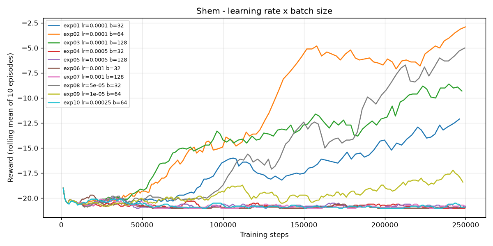
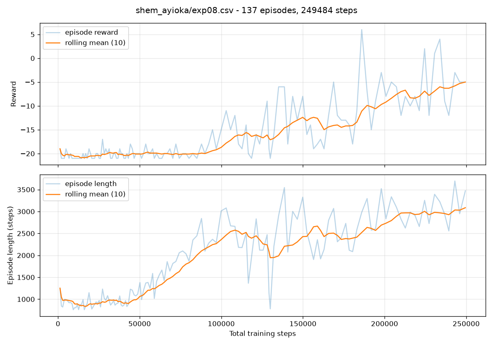
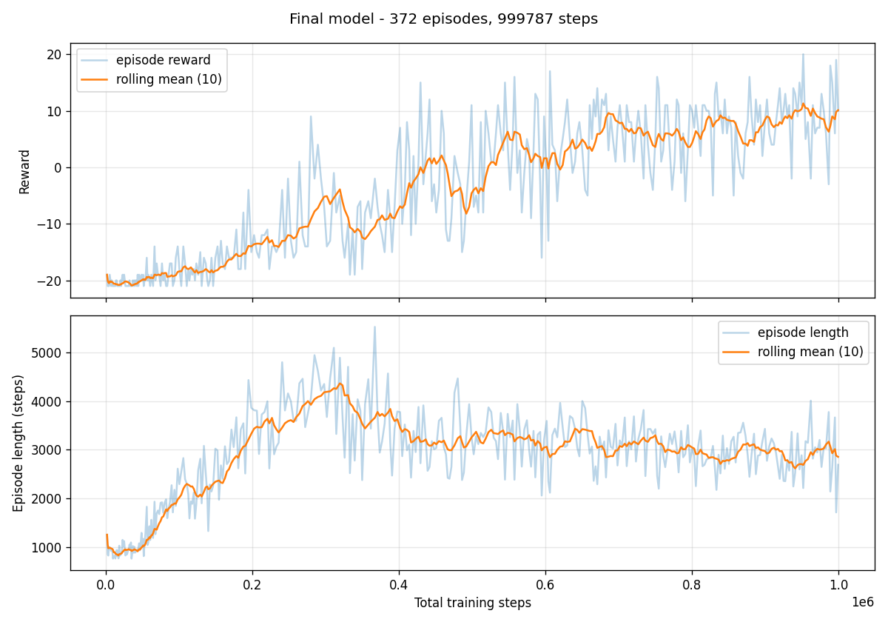

# Hyperparameter Experiment Results

**Member Name:** Shem Ayioka (Member A)
**Environment:** ALE/Pong-v5
**Main focus:** learning rate x batch size
**Same for all runs:** 250,000 training steps, buffer 50,000, learning starts 10,000, target update every 1,000 steps, seed 42, trained on a Colab T4 GPU

**How to read the numbers:** Pong scores go from -21 to +21. A random agent scores about -20. "Training reward" is the mean of the last 10 training episodes. "Eval" is the mean of 5 games with the saved model always taking its best action (no exploration), from `evaluate.py`.

| Experiment | Learning rate | Gamma | Batch size | Epsilon start | Epsilon end | Epsilon decay (steps) | Observed behaviour |
|---|---|---|---|---|---|---|---|
| 1 (exp01) | 1e-4 | 0.99 | 32 | 1.0 | 0.01 | 50,000 | Baseline. Stayed near -20 until about 86,000 steps, then improved slowly and was still rising at the end. Training reward -12.1, eval -11.8. |
| 2 (exp02) | 1e-4 | 0.99 | 64 | 1.0 | 0.01 | 50,000 | Best training reward (-2.9, best episode +5). Started improving at about 56,000 steps, 30k earlier than exp01. Flattened between 150k and 220k steps, then rose again. Eval -6.2, lower than its training reward. |
| 3 (exp03) | 1e-4 | 0.99 | 128 | 1.0 | 0.01 | 50,000 | Started improving at about 55,000 steps like exp02 but climbed more slowly. Training reward -9.3, eval -6.6. A bigger batch helped over 32, but 128 was not better than 64. |
| 4 (exp04) | 5e-4 | 0.99 | 32 | 1.0 | 0.01 | 50,000 | Did not learn. Lost every game 0-21 from start to end, with short episodes (~800 steps). Training reward -21.0, eval -21.0. |
| 5 (exp05) | 5e-4 | 0.99 | 128 | 1.0 | 0.01 | 50,000 | Did not learn. Same as exp04: a larger batch did not fix the high learning rate. Training reward -20.8, eval -21.0. |
| 6 (exp06) | 1e-3 | 0.99 | 32 | 1.0 | 0.01 | 50,000 | Did not learn. Training reward -20.9, eval -21.0. Updates were too large for the network to settle. |
| 7 (exp07) | 1e-3 | 0.99 | 128 | 1.0 | 0.01 | 50,000 | Did not learn. Training reward -20.8, eval -21.0. Same result as exp06 with a 4x bigger batch. |
| 8 (exp08) | 5e-5 | 0.99 | 32 | 1.0 | 0.01 | 50,000 | Best eval score (+3.6, won 3 of 5 games) and best single training episode (+6). Started late (about 100,000 steps) but improved steadily and was still rising at the end. Training reward -5.0. |
| 9 (exp09) | 1e-5 | 0.99 | 64 | 1.0 | 0.01 | 50,000 | Learning rate too small. Only started to move after about 100,000 steps and ended at -18.4 training, -18.2 eval. Would need far more steps. |
| 10 (exp10) | 2.5e-4 | 0.99 | 64 | 1.0 | 0.02 | 50,000 | Did not learn. Training reward -20.9, eval -21.0. Even a middle learning rate of 2.5e-4 was too high for this setup. |

| Exp | Episodes | Training reward (last 10) | Best episode | Eval (5 games) | Eval scores |
|---|---|---|---|---|---|
| exp01 | 150 | -12.1 | -4 | -11.8 | -11, -8, -13, -11, -16 |
| exp02 | 139 | **-2.9** | 5 | -6.2 | -8, -3, -15, -7, 2 |
| exp03 | 126 | -9.3 | -3 | -6.6 | -17, 2, -5, -4, -9 |
| exp04 | 306 | -21.0 | -19 | -21.0 | -21 x5 |
| exp05 | 302 | -20.8 | -17 | -21.0 | -21 x5 |
| exp06 | 310 | -20.9 | -18 | -21.0 | -21 x5 |
| exp07 | 306 | -20.8 | -18 | -21.0 | -21 x5 |
| exp08 | 137 | -5.0 | **6** | **3.6** | -5, -3, 10, 13, 3 |
| exp09 | 220 | -18.4 | -14 | -18.2 | -19, -19, -20, -17, -16 |
| exp10 | 303 | -20.9 | -18 | -21.0 | -21 x5 |

## Best experiment: exp08

Training performance of exp08 (episode length, steps and reward):

## Summary

- **Best configuration:** exp08 (lr 5e-5, batch 32). Highest eval score (+3.6) and the only model that wins more points than it loses. exp02 (lr 1e-4, batch 64) had the best training reward (-2.9).
- **Worst configuration:** every run with lr 2.5e-4 or higher (exp04, 05, 06, 07, 10). None of them learned at all.
- **What helped:** a learning rate of 1e-4 or 5e-5. At lr 1e-4, a batch of 64 or 128 started learning about 30k steps earlier than 32.
- **What hurt:** a learning rate that is too high (2.5e-4 and above), which stopped learning completely whatever the batch size, or too low (1e-5), which learned very slowly.
- **Why longer episodes:** episodes grow from ~800 steps (losing 0-21) to ~3,000 steps as the agent starts returning the ball, so the runs that learned have fewer episodes.
- **Caveats:** one seed per setting and 5 eval games per model, so gaps of a few points (exp02 vs exp03 eval) are not reliable. exp08 and exp09 change both learning rate and batch size compared to the baseline.

## Final configuration

I chose **exp08 (lr 5e-5, batch 32, gamma 0.99, epsilon 1.0 -> 0.01 over 50,000 steps)**. It had the best eval score and was the only model with a positive average. Its curve was still rising at 250k steps, so it is the one trained longer to produce the final `dqn_model.pth`. exp02 has a higher training reward, but it plateaued in the middle of training and scored lower when playing greedily.

## Final model (`dqn_model.pth`)

exp08's configuration trained for 1,000,000 steps instead of 250,000. Everything else is the same. The model is saved in the repo root as `dqn_model.pth`, which `play.py` loads by default.

| Steps | Episodes | Training reward (last 10) | Best episode | Eval (10 games) | Eval scores |
|---|---|---|---|---|---|
| 1,000,000 | 372 | 10.1 | 20 | **13.0** | 20, 10, 16, 7, 13, 11, 15, 16, 11, 11 |

| Steps | Mean training reward | Mean episode length |
|---|---|---|
| 0 - 100k | -19.9 | 1,178 |
| 100k - 200k | -16.8 | 2,577 |
| 200k - 300k | -9.8 | 3,828 |
| 300k - 400k | -9.7 | 3,702 |
| 400k - 500k | -1.8 | 3,167 |
| 500k - 600k | 2.3 | 3,194 |
| 600k - 700k | 5.1 | 3,134 |
| 700k - 800k | 5.4 | 3,091 |
| 800k - 900k | 7.3 | 2,928 |
| 900k - 1M | 9.3 | 2,857 |

- Won all 10 eval games (+13.0 average), up from +3.6 for exp08 at 250k steps.
- The average training reward passed 0 at about 500k steps and was still rising at 1M.
- Episode length peaked at about 300k steps (~4,000 steps, long close games) and then dropped to about 2,900 as the agent started winning points faster.
